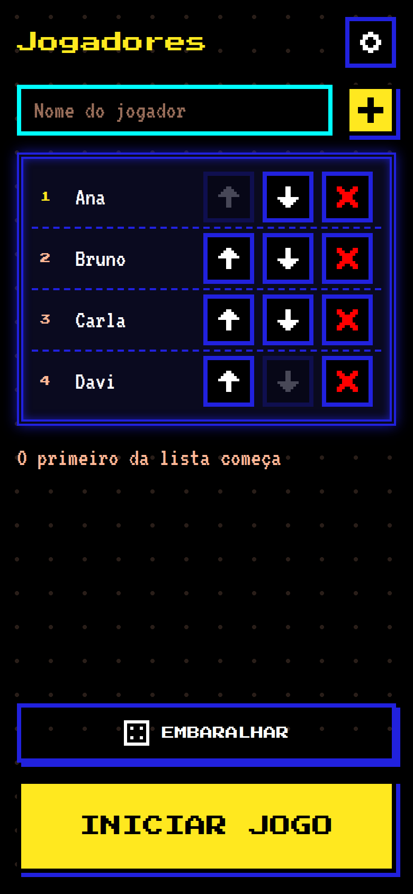
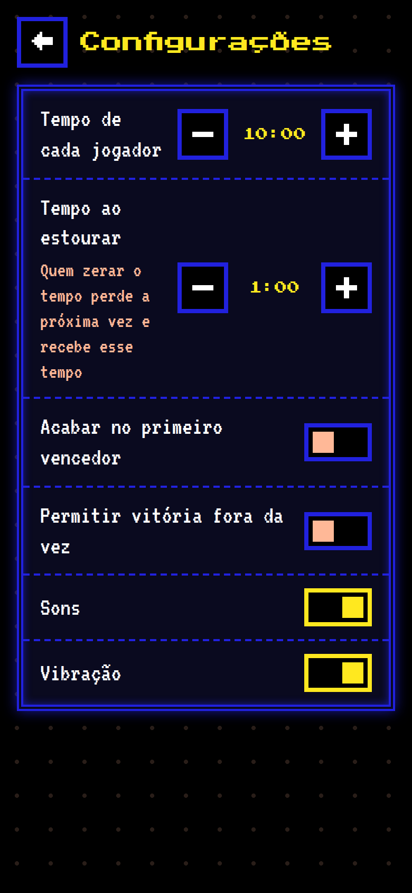
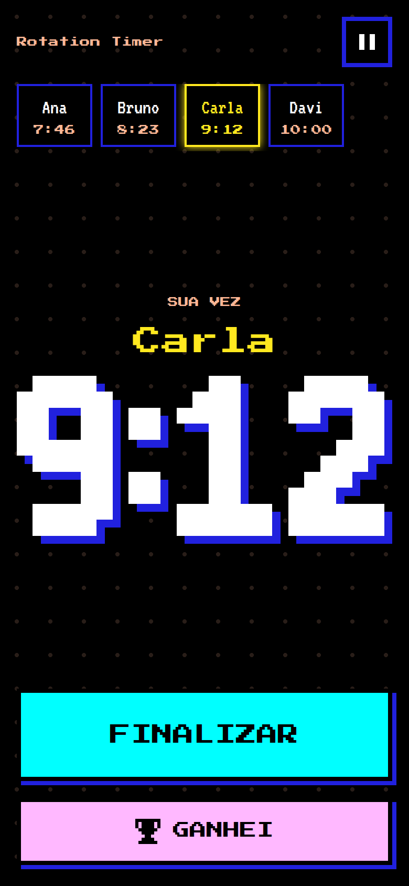
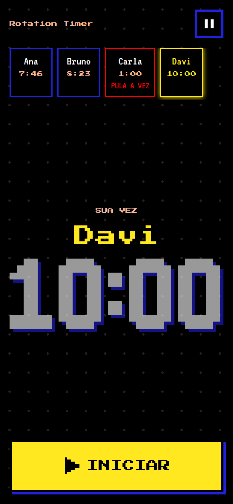
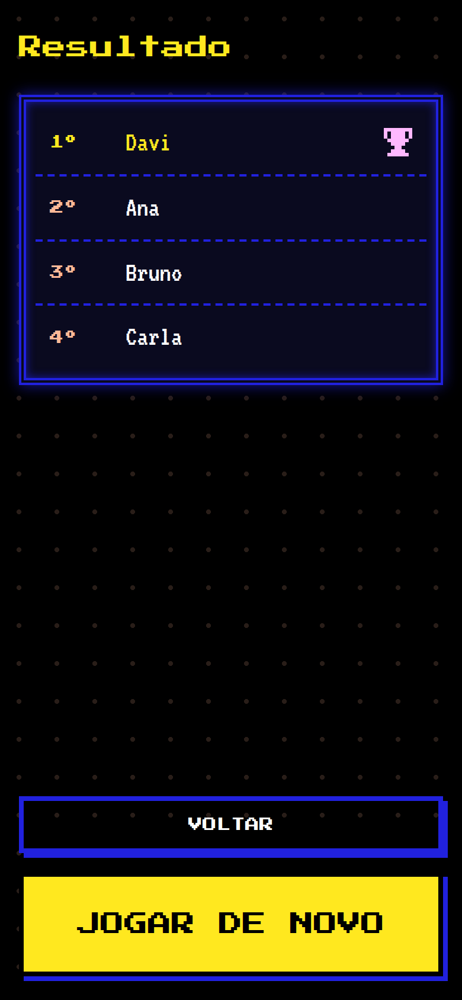

# Rotation Timer

A pixel-art PWA turn timer for card games. Each Player has a **Time Bank** that only drains during their own Turn. When it runs out they lose the rest of that Turn, get a **Refill**, and sit out their next Turn. The UI is in Brazilian Portuguese.

<p align="center">
  
  
  
  
  
</p>

- [`GLOSSARY.md`](./GLOSSARY.md): the domain language (Player, Time Bank, Timeout, Refill…)
- [`docs/SPEC.md`](./docs/SPEC.md): screens, rules, feedback and design system
- [`docs/adr/`](./docs/adr/): architectural decisions

## Run locally

There is no build step: the repository is the site.

```sh
npm start        # python3 -m http.server 8080, then open http://localhost:8080
npm test         # node --test (domain rules)
```

Any static file server works. The service worker needs `localhost` or HTTPS.

## Layout

```
index.html, manifest.webmanifest, sw.js
styles/      tokens.css (design tokens), base.css, components.css
src/
  main.js    app shell: UI state, actions, clock loop, persistence
  strings.js all pt-BR copy
  domain/    pure rules (no DOM, no clock): game, roster, settings
  platform/  audio (WebAudio), haptics, storage, wake lock
  ui/        DOM helper, pixel icons, screens, modals/toast, confetti
test/        node --test suites for the domain
fonts/, icons/
```

## Deploying

Push to a GitHub Pages branch as-is. When you add or rename a file, add it to `PRECACHE` in `sw.js` and bump `CACHE_VERSION`. Bump the version on every release as well, so installed apps pick up the update.
